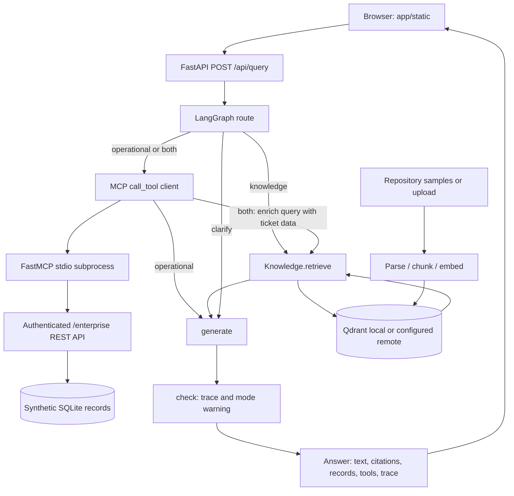

# Architecture Walkthrough

This guide explains the Enterprise AI Knowledge & Automation Platform as implemented in this repository. It is a synthetic portfolio demonstration, not evidence of prior customer production deployment. The public demo is [Enterprise Intelligence](https://enterprise-ai-knowledge-automation.onrender.com/).

The central design decision is to distinguish **document evidence** from **operational records**. A policy document can explain how to respond to an incident. It cannot establish whether a particular order is currently in transit. The application routes those questions through different paths and makes the evidence, tools and execution trace visible.

## 1. Read the repository in this order

| File | Important symbols | Responsibility |
| --- | --- | --- |
| [app/main.py](../app/main.py) | `app`, `lifespan()`, `query()`, `ingest()`, `auth()`, `enterprise_auth()`, `request_log()`, `health()`, `status()` | HTTP entry points, startup, authentication, concurrency, logging and error boundaries |
| [app/models.py](../app/models.py) | `Query`, `Answer`, `Citation`, `Customer`, `Order`, `Ticket` | Validated API contracts |
| [app/workflow.py](../app/workflow.py) | `State`, `TOOL_DEFINITIONS`, `make_graph()` and its nested nodes | Bounded orchestration and optional model calls |
| [app/knowledge.py](../app/knowledge.py) | `Knowledge.__init__()`, `embed()`, `ingest()`, `retrieve()`, `count()` | Parsing, vectors, Qdrant storage and citation metadata |
| [app/mcp_client.py](../app/mcp_client.py) | `ALLOWED`, `call_tool()` | MCP session lifecycle and tool invocation |
| [app/mcp_server.py](../app/mcp_server.py) | `server`, `get()`, four decorated tool functions | MCP-to-REST adapter |
| [app/enterprise.py](../app/enterprise.py) | `router`, `connect()`, `seed()`, `one()`, `customer()`, `order()`, `ticket()`, `tickets()` | Synthetic operational service backed by SQLite |
| [app/config.py](../app/config.py) | `Settings`, cached `settings()` | Environment-driven configuration |
| [app/static/app.js](../app/static/app.js) | `api()`, `node()`, form/connect/upload handlers | Browser requests and safe display of results |
| [render.yaml](../render.yaml), [Dockerfile](../Dockerfile) | Free service, image build and startup command | Deployment and disposable runtime storage |

The browser interface is static HTML/CSS/JavaScript served by FastAPI, not Streamlit or a separate frontend service. There is no conversational history or durable agent memory. Each submission runs a new graph invocation.

## 2. Component boundaries



These are logical boundaries within a small deployment. FastAPI serves both the application API and the enterprise REST API. The MCP server is a real child process, but it is not a separately hosted network service or a security sandbox. Qdrant local mode runs through the Python client without a separate database container.

## 3. Startup and reconstruction

`lifespan()` in `app/main.py` runs before requests are served:

1. Load `Settings` from the environment and optional `.env`.
2. Run `enterprise.seed()` in a worker thread. It creates missing tables and uses `INSERT OR IGNORE` for synthetic rows.
3. Construct `Knowledge(cfg)` in a worker thread. This initializes the embedding backend and opens/creates the Qdrant collection.
4. Enumerate supported files directly under `SAMPLE_DOCUMENTS_PATH`, sort them, and call `Knowledge.ingest()` for each. Startup supports `.md`, `.txt` and `.pdf`; it does not recurse into subdirectories.
5. Store the knowledge object, compiled graph and query semaphore on `app.state`.
6. Yield control so the application can serve traffic. Close the Qdrant client on shutdown or an indexing failure inside the lifecycle's `try/finally`.

Missing or empty sample directories and parsing/indexing failures prevent readiness. The current samples are `accounts.md`, `escalation.md` and `refunds.md`. On the verified deployment, they produced three chunks total. That is a property of these short samples, not a fixed application limit.

Every startup re-indexes sample sources, even if an existing index survives. Seed rows that already exist are retained, not reset to their original values. Other indexed sources remain if the filesystem survives. The implementation does not automatically remove a previously indexed source merely because its sample file was deleted from the repository.

`GET /health` returns a constant healthy response once startup completes. It does not recheck Qdrant, SQLite, model readiness or an external provider on each request. `GET /api/status` requires the application key and counts indexed chunks. These are useful demo checks, not a complete liveness/readiness dependency model.

## 4. End-to-end request flow

Consider: **“According to policy, what should happen next for ticket TKT-1001?”**

1. The query handler in `app/static/app.js` posts JSON to `/api/query`, adding the workspace key as `X-API-Key` and the selected `top_k`.
2. FastAPI calls `auth()` and validates `Query`: question length 3–4000 characters and `top_k` 1–10, default four.
3. `query()` acquires `app.state.query_slots`. It invokes the graph with `recursion_limit=10` and a 120-second timeout around graph execution. Time waiting for the semaphore is **outside** that timeout.
4. The `route()` node detects a record identifier and a policy-intent term, selecting `both`.
5. `tools()` validates the identifier and invokes `get_ticket` through the MCP client. The adapter calls the enterprise REST API, which returns the seeded P1/open ticket.
6. `retrieve()` appends operational JSON to the query. Recognized priority values add controlled retrieval terms; P1 adds “priority-one support incident escalation incident commander.” It then calls `Knowledge.retrieve()` in a worker thread.
7. `generate()` builds separate operational and policy sections. Without an OpenAI key, it displays operational JSON and cited source excerpts. With a key, it can request a grounded synthesis and validate citation identifiers before accepting it.
8. `check()` adds the final trace marker and an offline-mode warning when applicable.
9. FastAPI returns `Answer`: `answer`, `route`, `citations`, `operational_data`, `tools`, `trace`, `warnings`, `embedding_mode` and `generation_mode`.
10. The UI displays the answer and expandable sources/trace using text nodes. It does not interpret model output as HTML.

The combined trace is normally:

```text
route:both
tools:mcp:stdio:enterprise-rest
retrieve:qdrant
generate:grounded
check:citation-identifiers
```

Trace names are not assurance claims. `generate:grounded` appears for extractive generation too. The tools trace records the node's path even if a lookup fails; inspect `tools`, `warnings` and returned data to establish success.

## 5. The RAG path

### Parsing and chunking

`Knowledge.ingest(name, content)` parses PDFs with `pypdf.PdfReader` and preserves one-based page numbers. TXT/Markdown use UTF-8 decoding and page number one. Scanned PDFs without extracted text require upstream OCR; the application does not perform OCR.

Chunks are 220-word windows with a 180-word step, giving 40-word overlap for full adjacent windows. Chunk indices are zero-based and restart on each PDF page. The splitter uses whitespace-delimited words, not model tokens or section boundaries. These defaults are appropriate for short policy paragraphs, but table structure, headings and multi-column PDF reading order are not preserved reliably.

Each payload stores `source`, `page`, `chunk` and `text`. UUIDv5 point IDs derive from `name:page:index`. Embeddings are computed before deletion; the store then deletes the source's old points and upserts new points in batches of 64 while holding an in-process `RLock`.

This makes repeat ingestion and shorter replacements safe from duplicate/stale tail chunks. Delete/upsert is not transactional: a failure between operations can leave a partial source. Concurrent replacement is serialized inside one process, not across a distributed fleet. Filenames identify sources, so two uploads with the same basename replace the same source. There is no content hash, source revision history or tenant namespace.

### Embeddings and semantic retrieval

`Knowledge.embed()` has two explicit modes:

| Mode | Implementation | What can be claimed |
| --- | --- | --- |
| `fastembed` | `TextEmbedding('BAAI/bge-small-en-v1.5')`, local ONNX inference, 384 dimensions | Semantic text embeddings; the deployed profile uses this mode |
| `offline` | SHA-256 feature hashing over lowercase tokens, signed 384-dimensional counts, L2 normalization | Reproducible lexical baseline; **not** semantic understanding |

The generator and embedding backend are independent. Semantic retrieval does not require an OpenAI key. The offline warning is visible in the final response; the application does not silently substitute lexical retrieval when semantic initialization fails.

`Knowledge.retrieve()` embeds the query and calls `QdrantClient.query_points()` with `limit=top_k` and `score_threshold=0.20`. It maps returned payloads to `Citation` objects with request-local IDs `S1`, `S2`, etc. Scores are cosine similarity values, not probabilities of truth. There is no reranker, lexical/semantic fusion, learned relevance classifier or query-time metadata filter. The low fixed threshold can admit loosely related documents.

### Qdrant storage

`Knowledge.__init__()` selects remote Qdrant when `QDRANT_URL` is set; otherwise it uses `QDRANT_PATH`. Collections are named `knowledge_fastembed_v1` or `knowledge_offline_v1`, using 384-dimensional cosine vectors. Source metadata is already used for deletion filters and supports future filter design, but document-level access controls are not implemented.

Do not describe local mode as a distributed vector service or assume its performance characteristics match a remote Qdrant cluster. A change in embedding model or vector schema should create/rebuild a suitable versioned collection; dimension compatibility alone does not make embeddings interchangeable.

## 6. LangGraph state and routing

`State` is a `TypedDict(total=False)` describing graph state. It documents fields for static typing; it is not runtime Pydantic validation of every intermediate value. `Query` and `Answer` validate the external contracts.

`make_graph(kb)` defines five meaningful stages with nested functions and compiles a `StateGraph`:

| Route | Selection in `route()` | Execution after routing |
| --- | --- | --- |
| `knowledge` | Policy-intent substring, no recognized record ID | `retrieve → generate → check` |
| `operational` | ORD/CUST/TKT identifier, no policy-intent substring | `tools → generate → check` |
| `both` | Both conditions | `tools → retrieve → generate → check` |
| `clarify` | Neither condition | `generate → check` |

Policy-intent substrings include `policy`, `refund`, `escalat`, `sla`, `priority`, `p1`, `next`, `account` and `service level`. Record detection uses a regex for ORD/CUST/TKT followed by digits. This is a transparent heuristic router, not an LLM intent classifier. It can misroute paraphrases and ambiguous wording.

There are conditional edges after `route` and `tools`, and no cycles. No checkpointer, durable graph state, conversational memory, autonomous planning loop or human-approval node is configured. This is a controlled workflow with an optional model-assisted tool selection stage.

## 7. MCP, function selection and REST integration

### What actually executes

`tools()` extracts identifiers and builds allowed calls before consulting any model. Customer questions containing `TICKET` select `list_customer_tickets`; other customer-ID questions select `get_customer`. The orchestration path lists open tickets by default. Although the MCP tool supports a `status` argument, the current LLM schema and deterministic call builder do not expose arbitrary ticket-status selection.

When `OPENAI_API_KEY` is configured, the code calls `AsyncOpenAI.chat.completions.create()` with `TOOL_DEFINITIONS` and `tool_choice='required'`. Proposed calls are accepted only if every `(name, arguments)` tuple is present in the deterministic candidate list. Otherwise the original candidate list remains. At most four calls execute sequentially. This is a single selection request, not a general repeated assistant/tool-message conversation.

### Protocol flow

1. `app/mcp_client.py:call_tool()` checks the `ALLOWED` tool-name set.
2. It creates `StdioServerParameters` using `sys.executable -m app.mcp_server`.
3. It explicitly forwards `API_BASE_URL` and `ENTERPRISE_API_KEY`. This matters because the SDK's default subprocess environment does not inherit arbitrary service variables.
4. `stdio_client()` launches the process; `ClientSession.initialize()` establishes the MCP session; `session.call_tool()` sends the request.
5. `app/mcp_server.py` runs `FastMCP('Synthetic Enterprise Tools')` on stdio. Tool decorators provide typed schemas. Stdout is reserved for protocol traffic.
6. The decorated function calls `get()`, which uses `httpx.AsyncClient` and `X-Enterprise-Key` against the configured HTTP base URL.
7. The client rejects MCP error results, returns structured content when present, or parses text-content JSON into a `result` wrapper. Consumers must tolerate this wrapper; records are not guaranteed to be flat dictionaries.

| MCP tool | REST endpoint | Enterprise function |
| --- | --- | --- |
| `get_customer(customer_id)` | `GET /enterprise/customers/{customer_id}` | `customer()` |
| `get_order_status(order_id)` | `GET /enterprise/orders/{order_id}` | `order()` |
| `get_ticket(ticket_id)` | `GET /enterprise/tickets/{ticket_id}` | `ticket()` |
| `list_customer_tickets(customer_id, status='open')` | `GET /enterprise/customers/{customer_id}/tickets?status=...` | `tickets()` |

`enterprise.one()` selects a row using parameterized identifier values and fixed table names supplied by route code. `tickets()` validates customer existence and optional status. Missing rows produce 404; invalid status produces 422. `Customer`, `Order` and `Ticket` are response models, and FastAPI exposes OpenAPI documentation.

MCP is the tool protocol and adapter boundary; REST is the underlying operational integration. Neither replaces business authorization. The SQLite tables are not accessed directly by the orchestrator or MCP tools. A future Salesforce/ServiceNow adapter would need real authentication, permissions, pagination, rate-limit handling and contract mapping. There is no such customer integration in this demo.

## 8. Grounding and citations

Without an OpenAI key, `generate()` returns retrieved passages verbatim with `[S#]` references, plus a separate simulated-operational-data section. It is extractive evidence presentation, not a hosted LLM answer. When retrieval returns nothing, the knowledge path reports inadequate evidence.

With a key, the model receives a system instruction to use supplied evidence, treat it as untrusted data, separate operational data from policy, cite policy claims and acknowledge missing evidence. The user message contains JSON with the question and evidence sections.

The **actual citation-ID guard is inside `generate()`**. A candidate must be nonempty, use no unknown `[S#]` identifiers and include at least one recognized citation if policy excerpts exist. Failure or provider error preserves the extractive fallback and adds a warning. It does not check every claim, entailment, completeness or factual accuracy. The separate `check()` node adds a trace marker and offline-mode warning; it does not run another semantic grounding evaluator.

`/api/status` describes the configured generation mode. `Answer.generation_mode` describes the mode actually used for that response, including fallback. Neither similarity scores nor valid citation IDs prove a claim is supported.

## 9. Evaluation and observability

| Evidence | Exact implementation | Limits |
| --- | --- | --- |
| Automated tests | `tests/test_platform.py`, `test_ingestion.py`, `test_generation.py`, `test_startup.py`, `test_deployment.py`, `test_mcp_config.py` | 14 passing cases in the verified implementation; model calls use mocks |
| HTTP/MCP acceptance | `scripts/evaluate.py:CASES`, `main()` | Seven questions; checks routes, expected substrings, citation presence and tool use, not full answer correctness |
| Semantic ranking | `scripts/semantic_evaluate.py:main()` | Three paraphrases checked against expected top source; no broad retrieval benchmark |
| Stored results | `docs/evaluation-results.json`, `docs/semantic-evaluation-results.json` | Recorded runs, not continuous service monitoring |
| CI | `.github/workflows/test.yml` | Installs pinned dependencies, runs pytest, starts the API and runs real MCP acceptance using offline embeddings |

`request_log()` generates a request ID, adds `X-Request-ID`, and logs method, URL path, status and elapsed milliseconds. `query()` logs route and node trace; startup logs source filenames/chunk counts. The browser also exposes the graph trace and records.

There is no OpenTelemetry span pipeline, metrics dashboard, token-cost accounting or distributed correlation propagated into the MCP subprocess. Internal REST requests receive their own IDs. Prompts/keys are not intentionally logged, but paths contain operational identifiers, parsing errors can expose metadata, and exception/dependency logs need review before sensitive data is introduced.

## 10. Security controls and their scope

- `auth()` and `enterprise_auth()` use `hmac.compare_digest` for separate application and enterprise shared keys. Render generates both values. Local defaults are demonstration credentials, not suitable public secrets.
- The UI keeps the entered key in the password field and sends it in a header; its code does not intentionally persist it in browser storage.
- The tool allowlist, explicit ID matching and read-only capabilities reduce action scope. No write tools, approval state or mutation endpoints exist. `writes_enabled=False` describes enterprise actions; authenticated document ingestion still modifies the index.
- Upload handling limits application reads to 5 MiB plus one byte, supports three file extensions, caps PDFs at 200 pages and reduces filenames to basenames. Multipart processing can occur before that application-level check; this is not a complete ingress-size, malware or decompression defense.
- SQL value parameters, frontend `textContent`, asset allowlisting, CSP and `nosniff` provide basic defenses. Documentation pages permit CDN assets and inline code through a separate CSP.
- `.env` variants and runtime data are ignored; `.env.example` contains development defaults/placeholders only. Never add production credentials to samples, screenshots, guides or evaluation artifacts.

There is no OIDC, RBAC, per-document ACL, tenant isolation, user-specific audit trail, request-rate limiter or parser sandbox. A shared key grants access to the whole demo workspace. Prompt injection remains possible through question/document content. A grounding instruction is one layer, not a security boundary. Read-only tool design limits mutations but does not prevent unauthorized disclosure if real confidential data is added without access control.

## 11. Configuration and Render deployment

`Settings` uses `pydantic-settings`, reads `.env` and environment values, ignores unknown fields, and is cached by `settings()`. Restart to pick up normal configuration changes. Runtime defaults and deployment overrides differ:

| Setting | Local default / purpose | Render profile |
| --- | --- | --- |
| `EMBEDDING_MODE` | `fastembed` | `fastembed` |
| `EMBEDDING_THREADS` | 1, validated 1–8 | 1 |
| `MAX_CONCURRENT_QUERIES` | 4, validated 1–16 | 1 |
| `SAMPLE_DOCUMENTS_PATH` | `samples` | Repository samples in image |
| `QDRANT_PATH` | `data/qdrant` | `/app/data/qdrant`, ephemeral |
| `ENTERPRISE_DB_PATH` | `data/enterprise.sqlite3` | `/app/data/enterprise.sqlite3`, ephemeral |
| `MODEL_CACHE_PATH` | `data/models` | `/app/data/models`, model bundled in image |
| `QDRANT_URL`, `QDRANT_API_KEY` | Optional remote backend | Unset in initial deployment |
| `API_BASE_URL` | `http://127.0.0.1:8000` | Same-service loopback REST address |
| `APP_API_KEY`, `ENTERPRISE_API_KEY` | Distinct local demo defaults | Generated secrets |
| `OPENAI_API_KEY`, `OPENAI_MODEL` | Optional generation; default model name `gpt-4.1-mini` | No provider key needed for extractive demo |

The Dockerfile builds from Python 3.12 slim, installs system/native and pinned Python dependencies, copies application/samples, downloads the public embedding model, then runs as a non-root user. Uvicorn binds `0.0.0.0:8000` with one worker. The Docker health command and Render health path both use `/health`.

The Blueprint declares one Free Docker web service in Virginia, no disk or managed datastore, and `autoDeployTrigger: 'off'`. It limits ONNX/OpenMP threads and query concurrency. Local Compose is different: it optionally mounts a named data volume. That does not imply the Render instance has persistence.

The initial deployment of application commit `fd5dd42` was verified on October 31, 2026: Render reported Live; health/UI worked; all three samples indexed with FastEmbed; a cited P1 policy query succeeded; and the MCP order lookup returned ORD-1003 as in transit. This was a functional smoke test, not a capacity, resilience or security certification. Hosted model calls and live Qdrant Cloud remain separate unverified capabilities.

Render's ephemeral files and idle cold starts are acceptable for a disposable portfolio demo. UI-uploaded sources are lost on reset unless added to the repository samples or re-ingested into durable storage. Future approved persistence is configurable through paths or Qdrant Cloud without redesigning the graph. Cloud vectors alone do not make SQLite operational data durable or reduce local embedding memory.

## 12. Failure modes, latency, scaling and cost

| Condition | Current behavior | Production improvement |
| --- | --- | --- |
| Invalid input or wrong key | 422 or 401 | Identity-aware API policy and rate limits |
| Bad/empty/scanned upload | 422; oversize application read gives 413 | Isolated parsing, OCR, upstream size enforcement, durable ingestion jobs |
| Missing operational row / tool error | Direct REST 404; graph warns and preserves other evidence | Typed adapter errors, retries by failure class, circuit breaking |
| Retrieval/Qdrant exception | Unhandled dependency errors reach generic 500 boundary | Explicit dependency health and controlled degradation |
| No retrieval evidence | Abstention text | Better relevance calibration and labeled unsupported-query tests |
| Provider failure / invalid citation IDs | Extractive fallback and warning | Provider monitoring plus per-claim support evaluation |
| Long execution | Graph timeout returns 504; per-tool 25s, adapter HTTP 10s | End-to-end deadlines including queue time |
| Qdrant replacement failure | Possible partially replaced source | Versioned atomic publication and resumable ingestion |
| Ephemeral reset | Seed/re-index samples; uploads disappear | Optional durable source store, vectors and operational database |

Optional model tool selection uses a 20-second SDK timeout and generation uses 25 seconds, each with `max_retries=1`; these are not guarantees of total stage wall time. Cancellation of a thread-offloaded embedding/storage operation does not necessarily stop the underlying synchronous work immediately. The semaphore bounds active query execution, not queue length, total requests or concurrent admin uploads.

Latency includes queueing, query embedding, retrieval, optional provider calls and MCP process startup. Each tool creates a fresh Python process/session and tools execute sequentially; this is an intentional simplicity trade-off, not optimized agent infrastructure. Priorities for improvement are measurements by stage, a managed MCP process/session pool, embedding/result caching with authorization-aware keys, and bounded parallelism only where operational calls are independent.

Local Qdrant's shared-path lock prevents simply adding Uvicorn workers. A scale-out design would use a remote vector service, durable operational data, a separate ingestion queue, external source storage and user/tenant authorization. Bounded execution remains useful, but connection lifecycle, distributed rate limits, backpressure and observability must be redesigned for a fleet.

The deployed profile incurs no configured paid Render resource and requires no inference API for extractive answers. Local embeddings still consume CPU/RAM and cold-start/build resources. Optional hosted generation introduces token/request charges and additional data handling. No current prices, throughput targets, uptime guarantees or production savings are established by these tests.

## 13. Senior Solutions Architect Interview Walkthrough

Use the repository as a working design discussion, with a clear demonstration/experience boundary.

1. **Start with the decision:** “I built a synthetic portfolio system to show how policy retrieval and operational integration can work together. I chose a small implementation I could deploy, inspect and test end to end.”
2. **Show the user boundary:** Open the deployed UI, connect with the application key, and show semantic/extractive mode and the indexed chunk count. Do not expose the key in an interview recording.
3. **Trace policy evidence:** Ask the P1 escalation question. Open `Knowledge.ingest()` and `retrieve()`, explain the word windows and cosine lookup, then expand the source citation. State that a valid citation ID is not proof of entailment.
4. **Trace operational truth:** Ask for ORD-1003. Follow `tools()` → `call_tool()` → `get_order_status()` → `get()` → `enterprise.order()`. Show the MCP/REST trace and synthetic in-transit result.
5. **Connect both paths:** Use TKT-1001 with a policy question. Explain why tools run before retrieval: the returned P1 priority adds useful search context. Show conditional edges and the typed state in `make_graph()`.
6. **Defend the boundaries:** Explain deterministic routing, candidate-call validation, separate keys, no write tools, controlled fallback and the lack of tenant ACLs. Distinguish the real MCP integration from the optional LLM function-selection path.
7. **Show evidence, then limits:** Point to the 14 tests, seven-case acceptance script and three semantic paraphrases. Explain why this does not establish production reliability or comprehensive answer quality.
8. **Present a practical next design:** Discuss identity/document permissions, evaluation data, durable sources, Qdrant Cloud, an operational adapter and MCP lifecycle optimization. Choose changes based on workload and risk, not the presence of an AI framework.

A useful closing answer: “The portfolio demonstrates implementation and architectural judgment. I would not present its synthetic records, small test set or Free-tier deployment as previous customer production AI experience.”
