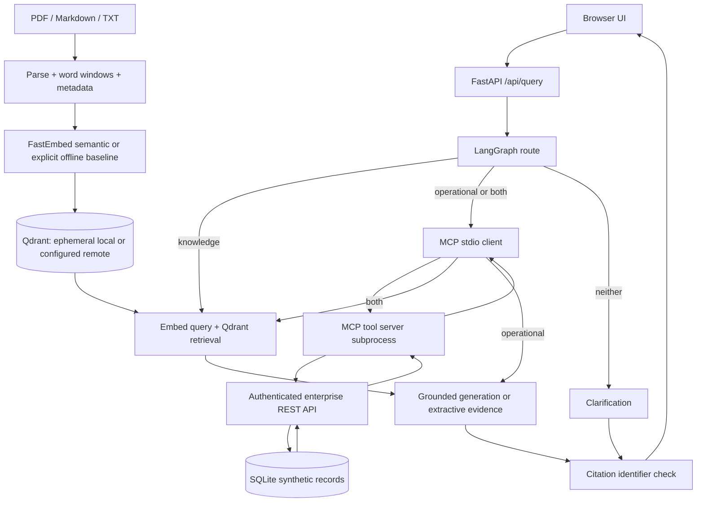

# Architecture and implementation notes

## Boundaries and failure behavior

FastAPI owns application lifecycle, one Qdrant connection, a compiled graph and a configurable query semaphore (`MAX_CONCURRENT_QUERIES`, default four; one on Render Free). Embedding threads are separately bounded by `EMBEDDING_THREADS` (default one). Sync embedding, seeding and storage operations run in worker threads. Query execution has a 120-second bound; MCP operations have a 25-second bound; HTTP adapters time out after ten seconds. Failed record retrievals are shown as warnings without inventing status. Shared-key authentication gates ingestion/query and separately gates enterprise data. UI rendering uses textContent, never unsanitized model HTML. Uploaded filenames are reduced to basenames and are metadata, never disk destinations. SQL values are parameterized. The only interpolated table identifiers come from fixed route constants.

Knowledge and operational data remain distinct in state and API responses. The generator is told evidence is untrusted and to avoid invented claims. No graph tools can mutate enterprise records. Source documents can still contain misleading facts; prompt defenses and citation checks do not establish truth or prevent all injection.

The LangGraph state includes route, top-k, citations, operational records, tools, warnings, trace and answer. The developer trace exposes actual node execution. LangChain's core interfaces are brought by LangGraph; there is no additional chain abstraction because direct Qdrant and SDK calls make the flow easier to inspect.

## Intentional scope

Single tenant, small corpus, seeded SQLite, synchronous ingestion and read-only operations minimize infrastructure. No autonomous follow-up loops, background write actions or fake external business integrations. A future write feature must stage a proposal and require explicit user approval tied to the exact action and arguments before a dedicated executor node runs.

## Deployment acceptance

Render is the selected provider. The initial Blueprint uses one Free Docker web service with an ephemeral filesystem, no disk and no external datastore. It does not require persistence: before readiness, startup creates missing SQLite tables/seed records and rebuilds sample-source chunks in Qdrant. The source of truth is repository code and the supported files directly under `SAMPLE_DOCUMENTS_PATH` (default `samples/`), not runtime database files. Sample re-indexing replaces chunks using stable IDs on every startup, including when files survive. Other existing sources are preserved. An empty/missing sample directory, parse error or index failure prevents startup; it is not reported as a healthy empty demo.

The Docker image bundles the embedding model at build time. New instances reconstruct vectors from repository samples using those weights; a cache miss can still download the model. `EMBEDDING_MODE=fastembed` remains semantic retrieval on the free profile. UI upload originals are not persisted, so their local vectors are lost on filesystem reset. To preserve a demo source across resets, add it to the repository samples and redeploy. Free services sleep on idle and have cold starts and usage limits. Actual free-tier memory use must be verified after deployment, including the MCP subprocess overhead. No paid resources should be created to resolve capacity issues without separate approval.

Storage remains configurable: `QDRANT_URL`/`QDRANT_API_KEY` select Qdrant Cloud; otherwise `QDRANT_PATH` selects local storage. `ENTERPRISE_DB_PATH` and `MODEL_CACHE_PATH` select record/model paths. A future approved persistent volume can hold those paths without changing the graph, MCP adapter or retrieval contracts. Cloud vectors can survive while local synthetic SQLite is reseeded. Non-demo operational state would need a durable operational backend. Changing embedding mode selects another collection and requires re-ingestion of custom sources.

Use one instance/worker for local Qdrant. Verify `/health`, authenticated `/api/status`, a citation query and an MCP operational query after deployment and after a restart. The Free/no-disk Blueprint has only been checked locally; repository publication and Render account connection are still needed. See [Render deployment](render-deployment.md).

## Evaluation limits

Regression results check expected facts, routes, citation presence and successful MCP use. They do not measure every sentence's support, tool argument accuracy on adversarial prompts, semantic ranking on diverse paraphrases, fairness or real-world policy correctness. Before a production use case, build a labeled corpus and evaluate retrieval recall@k, unsupported-answer rate, citation entailment and per-route latency under load. All supplied documents and records are synthetic.
